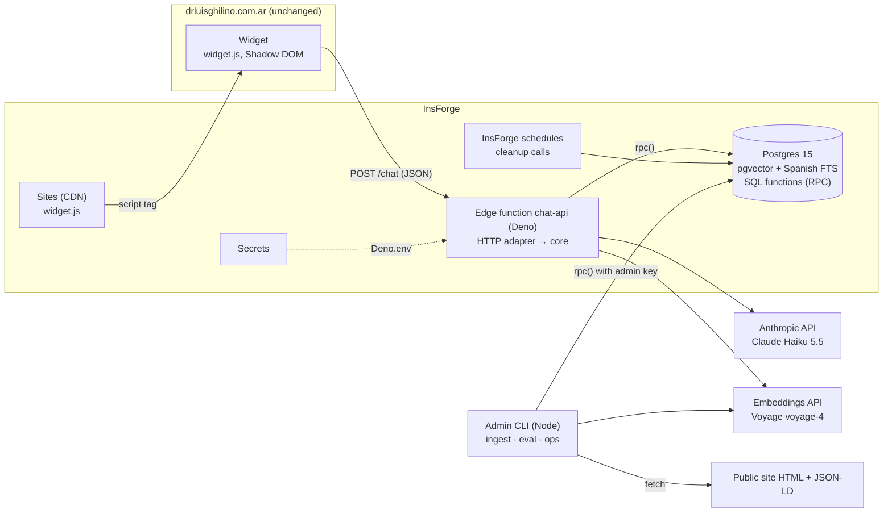
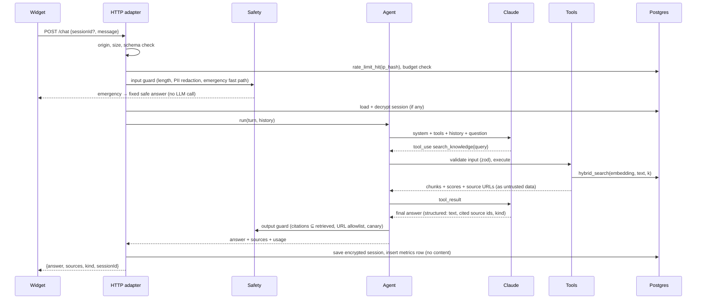

# Architecture

Status: **Phase 1** (2026-11-05). Verified against the real InsForge project where marked _verified_; sections marked _to verify_ depend on InsForge
behaviour that the docs do not state and that we check on a real project in Phase 1 or 8.

## 1. Goal and constraints

An informational and administrative assistant for https://drluisghilino.com.ar. It answers
in Spanish (Argentine "vos", as the site does), only from verified sources, cites them,
abstains when it cannot find support, and never gives medical advice.

Constraints that shape the design:

- **Backend on InsForge.** Postgres 15 with pgvector behind PostgREST, Deno edge functions,
  encrypted secrets, Sites (static hosting on Vercel's CDN), HTTP schedules. _Verified_: PostgreSQL 15.18, pgvector 0.7.4, the `spanish` text search config; `pg_cron` is installed but not callable by `project_admin`, so jobs go through InsForge schedules.
  No built-in rate limiting for functions. Function limits (timeout, memory) are not
  documented.
- **Anonymous public endpoint** that spends Anthropic credits, so abuse control and a cost
  ceiling are part of the core design, not an afterthought.
- **Medical context.** No conversation logs, short-lived sessions, minimal telemetry.
- **Small corpus today** (one page, about 2,500 tokens), designed to grow (PDFs, curated FAQs).
- **One agent, many channels.** The website widget now; WhatsApp later without touching the
  agent, the knowledge base or the safety rules.

## 2. Components



| #   | Component                                              | Where it runs                                               | Responsibility                                                                                                            |
| --- | ------------------------------------------------------ | ----------------------------------------------------------- | ------------------------------------------------------------------------------------------------------------------------- |
| 1   | **Widget** (`apps/widget`)                             | Visitor's browser, served by InsForge Sites                 | UI only. Holds no secrets, renders model output as text (never as HTML).                                                  |
| 2   | **HTTP adapter** (`apps/api`)                          | InsForge edge function (Deno); Node for local dev and tests | Routing, CORS, origin check, size limits, rate limiting, structured errors, wiring (composition root). No business logic. |
| 3   | **Agent orchestration** (`packages/core/agent`)        | Inside the function                                         | The tool-use loop, system prompt, conversation context, final-answer validation.                                          |
| 4   | **LLM provider** (`packages/core/llm`)                 | Inside the function                                         | `LlmProvider` port with neutral types; `AnthropicProvider` adapter (timeouts, retries, usage, cost).                      |
| 5   | **Retrieval** (`packages/core/retrieval`)              | Function + Postgres                                         | Query embedding, hybrid search, fusion, dedup, confidence gate, context assembly.                                         |
| 6   | **Ingestion** (`packages/core/ingestion` + `apps/cli`) | Admin's machine or CI, never public                         | Fetch, extract, clean, chunk, hash, embed, version, publish.                                                              |
| 7   | **Database** (`migrations/`)                           | InsForge Postgres                                           | Tables, indexes, and the SQL functions that are the only data API.                                                        |
| 8   | **Sessions** (`packages/core/sessions`)                | Function + Postgres                                         | Short-lived, encrypted conversation context with expiry and scheduled cleanup.                                            |
| 9   | **Safety** (`packages/core/safety`)                    | Function                                                    | Input guard, emergency fast path, PII redaction, output guard (URL allowlist, citation check, prompt-leak canary).        |
| 10  | **Observability** (`packages/core/observability`)      | Function + Postgres + CLI                                   | Content-free metrics per request, cost estimate, daily budget, ops report.                                                |

`packages/core` has **no Node, Deno or browser-specific imports**: it uses `fetch`,
WebCrypto and plain TypeScript. That is what lets the same code run in the Deno function,
in Node tests and in the CLI. Everything environment-specific is injected through ports.

## 3. Request lifecycle (one chat turn)



The model decides whether to call a tool ("agentic RAG"). Small talk ("hola", "gracias")
needs no retrieval. Factual questions about the practice are steered to tools by the system
prompt, and the output guard rejects factual answers that cite nothing (see §6).

## 4. Knowledge and retrieval

**Two kinds of knowledge**, because they have different shapes:

1. **Structured facts** (offices, hours, contact channels, fee, credentials) come from the
   page's schema.org JSON-LD, parsed deterministically (no LLM), stored in `clinic_facts` with
   their source URL. The tools `get_clinic_information`, `get_contact_information` and
   `get_appointment_information` read them. Precise, cheap, cacheable, and impossible to
   "half retrieve".
2. **Unstructured text** (descriptions, FAQ answers, "sobre mí", future PDFs) goes through
   the RAG pipeline and the `search_knowledge` tool.

**Ingestion** (`pnpm ingest`): fetch the allowlisted sources in
[docs/knowledge-inventory.md](docs/knowledge-inventory.md) → extract the main content and
drop navigation, scripts, styles and the contact form → keep headings, lists and the section
anchor ids → normalize Unicode and whitespace → **heading-aware chunking** (one chunk per
leaf section or FAQ pair; long sections split on paragraph boundaries with overlap; each chunk
is prefixed with its heading path, e.g. "Consultorios › Boulogne") → SHA-256 per document and
per chunk → embed only chunks whose hash is new → write a new **document version** in one
transaction and mark the previous one superseded. Unchanged documents are skipped, so
re-running is cheap and idempotent. Every run writes an `ingestion_runs` report.

**Hybrid search** is one SQL function, `hybrid_search(...)`:

- _Semantic_: cosine distance on `vector(1024)` with an HNSW index.
- _Lexical_: `websearch_to_tsquery('spanish', …)` against a `tsvector` of the accent-folded
  text, ranked with `ts_rank_cd`. Accent folding happens in TypeScript so we don't depend on
  the `unaccent` extension (available on InsForge but not installed, and absent from its docs).
- _Fusion_: Reciprocal Rank Fusion, `score = Σ 1 / (k + rank)`, `k = 60`. RRF uses ranks, not raw
  scores, so it can merge a cosine similarity and a `ts_rank` that live on different scales.
- Only chunks of the **current** version of each document, optional filters by section or
  document kind, duplicates collapsed by content hash, top-K (default 5).
- **Confidence gate**: the best cosine similarity must reach `RETRIEVAL_MIN_SIMILARITY`
  (tuned on the eval set in Phase 3). Below it the tool returns no passages, and the agent
  abstains.

No reranker for now: with dozens of chunks, a cross-encoder adds a vendor call and latency for
gains we can't measure yet. The retrieval eval (Recall@K, MRR) decides whether it earns its place.

## 5. Agent and LLM

- **Model**: `claude-haiku-5-5` by default ($0.10 / $0.50 per million input / output tokens
  for prompts up to 100K tokens), set by `LLM_MODEL`. Effort `low` by default (`LLM_EFFORT`);
  the eval compares `low` and `medium`. No sampling parameters (Haiku 5.5 rejects them).
- **Provider port**: the agent speaks neutral types (`LlmMessage`, `LlmToolCall`, `LlmUsage`).
  The Anthropic adapter maps them to the SDK and back, carrying Anthropic-only blocks (thinking
  signatures) as opaque values so tool loops replay them unmodified.
- **Tools**: four read-only tools with zod schemas, typed outputs and error results
  (`is_error`) instead of exceptions. Max 4 tool rounds per turn, wall-clock deadline per turn.
- **Final answer**: a validated structured object, `{ answer, sourceIds, kind }`, where `kind` is
  `answered | abstained | declined_medical | emergency | out_of_scope | smalltalk`. It makes
  abstention measurable and lets the server check citations. _To verify in Phase 4_: structured
  outputs combined with tools on Haiku 5.5, against a plain-text answer with citation markers.
- **Context management**: last 6 turns of plain text (no thinking blocks across turns, so the
  history stays append-only), retrieved context capped at about 2,000 tokens, `max_tokens` 1,024.

## 6. Safety and privacy (summary; details in SECURITY.md and PRIVACY.md)

- Retrieved text is **data**: wrapped in delimited `<source>` blocks, with a system rule that
  instructions inside sources are never followed. Tools are read-only, so a successful injection
  can at worst change wording, not take actions.
- The system prompt contains a random **canary**; any output containing it is replaced.
- Output URLs must belong to an allowlist (the site, its WhatsApp, phone, e-mail and map links).
- **Emergency fast path**: unambiguous emergency phrases get a fixed answer pointing to 107 /
  911 without calling the model.
- **PII**: phone numbers, e-mails and DNI-like numbers in the visitor's message are redacted
  before the model sees them, and the widget tells the visitor not to share them.
- **No conversation logs.** Session context is AES-GCM encrypted with a key that lives in
  function secrets, not in the database, expires after 30 minutes idle and is deleted by a
  scheduled cleanup call (InsForge schedules) plus opportunistic deletes on write. Metrics rows have no text.

## 7. Data model (first migration)

| Table                | Purpose                                                                                                                          |
| -------------------- | -------------------------------------------------------------------------------------------------------------------------------- |
| `sources`            | Allowlisted origins (id, url, kind, enabled).                                                                                    |
| `documents`          | One logical document per source key; `current_version_id`.                                                                       |
| `document_versions`  | Immutable snapshots: content hash, extracted text, fetched/indexed timestamps, status.                                           |
| `chunks`             | Text, heading path, anchor URL, token estimate, content hash, `embedding vector(1024)`, `embedding_model`, generated `tsvector`. |
| `ingestion_runs`     | Status, timing, counts and errors per run.                                                                                       |
| `clinic_facts`       | Structured facts with source URL and version.                                                                                    |
| `chat_sessions`      | Encrypted recent turns, channel, `expires_at`.                                                                                   |
| `rate_limit_buckets` | Fixed-window counters per hashed key.                                                                                            |
| `request_metrics`    | Content-free telemetry per request.                                                                                              |

Tables live in `public` (InsForge's convention; migrations run as `project_admin`, which may only
own objects there) with a `kb_` prefix for the knowledge base. _Verified_: InsForge grants `anon`
and `authenticated` SELECT/INSERT/UPDATE/DELETE on every new `public` table by default, so the
migration **revokes** them explicitly, and enables row-level security with **no policies** as a second
barrier. SQL functions revoke `EXECUTE` from `PUBLIC`, `anon` and `authenticated` and grant it to
`project_admin`, the role behind the server-side API key (_verified_: `current_user` for admin-key
calls; it has `BYPASSRLS`). A live test proves the public anon key gets `42501 permission denied`
on every table and function.

## 8. Why the data API is SQL functions

The InsForge SDK has a query builder and `rpc()`, but no raw SQL, no `or`, no full-text helper.
Hybrid search must be a SQL function anyway. Making **every** data operation a SQL function
(`hybrid_search`, `publish_document_version`, `rate_limit_hit`, `session_save`, ...) gives:

- one tiny `RpcClient` port in the core (`call(fn, args)`), with two adapters: InsForge `rpc()`
  in production, and plain SQL over PGlite in tests;
- the **same SQL** exercised by integration tests and by production;
- atomic multi-row operations (a function call is one transaction), which PostgREST alone does
  not offer.

## 9. Channels

```ts
interface InboundMessage {
  channel: "web" | "whatsapp";
  conversationId: string;
  text: string;
  receivedAt: Date;
}
interface OutboundMessage {
  text: string;
  sources: SourceRef[];
  kind: AnswerKind;
  actions: ContactAction[];
}
```

The web adapter turns the HTTP request into an `InboundMessage` and the result into JSON. A
future WhatsApp adapter (Meta Cloud API webhook, signature check, 24-hour window rules,
delivery retries) would be a second function that produces the same `InboundMessage`, maps
the phone number to a `conversationId` through a hashed lookup, and never shows the number to
the model. See docs/whatsapp-future.md (written in Phase 5).

## 10. Deployables

| Deployable               | Built from                                                                     | Hosted on                                                |
| ------------------------ | ------------------------------------------------------------------------------ | -------------------------------------------------------- |
| `chat-api` edge function | `apps/api` bundled with esbuild into one ESM file (npm deps as `npm:` imports) | InsForge Functions (Deno)                                |
| `widget.js` + demo page  | `apps/widget` built with Vite                                                  | InsForge Sites                                           |
| Database schema          | `migrations/*.sql`                                                             | `insforge db migrations up`                              |
| Knowledge base           | `pnpm ingest`                                                                  | Run by an admin; writes through admin-only SQL functions |

## 11. Risks and open questions

| Risk                                                             | Mitigation                                                                                                |
| ---------------------------------------------------------------- | --------------------------------------------------------------------------------------------------------- |
| Function timeout unknown (possibly 30 s)                         | Turn deadline 20 s, max 4 tool rounds, Haiku at low effort; measured in Phase 8.                          |
| SSE streaming from functions not demonstrated                    | v1 returns JSON with a typing indicator; streaming is a later, measured change.                           |
| Free plan pauses after 7 days without requests                   | Fine for development; production needs traffic, a keep-alive schedule, or Pro ($25/month, your decision). |
| Tests run on Postgres 18 (PGlite), production is 15              | Avoid features newer than 15; run migrations and a smoke test on the real project.                        |
| `pg_trgm` / `unaccent` available but not installed or documented | Not used. Accent folding in TypeScript.                                                                   |
| Origin header and IP can be spoofed or shared                    | Rate limit by hashed IP and session, plus a global daily budget; documented limits.                       |
| Embedding provider may use API data for training                 | Opt out at the provider before production (Voyage via MongoDB Atlas org settings).                        |
| Corpus is tiny, RAG may be overkill today                        | Eval includes a full-context baseline so the trade-off is measured.                                       |
