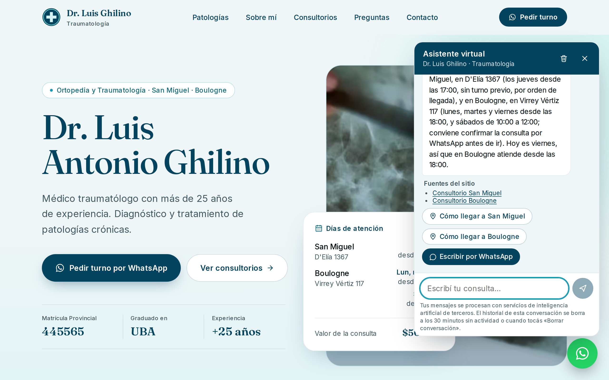
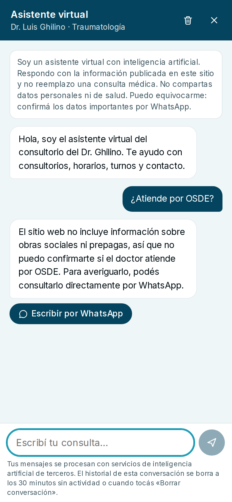
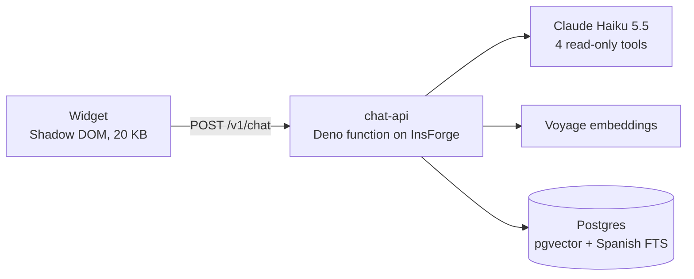

# Dr. Ghilino AI Assistant

A retrieval-augmented chat assistant for a real medical practice, live on
[drluisghilino.com.ar](https://drluisghilino.com.ar) (the floating WhatsApp button opens it). It
answers patients in Spanish about offices, hours, fees and services, cites the site, says so when
the site does not cover something, never gives medical advice, and points emergencies to 107 / 911
without calling the model.

<p>
  
  
</p>

## How it works



1. **Knowledge.** An admin CLI ingests an allowlist (the site and its `llms.txt`) into
   heading-aware chunks, embeds them with Voyage and publishes them as a new version in Postgres.
   Structured facts (offices, hours, fee, contact) are parsed from the page's schema.org data, not
   retrieved.
2. **Retrieval.** One SQL function fuses pgvector similarity and Spanish full-text search with
   Reciprocal Rank Fusion. A two-signal gate (close in meaning, or every term present) decides
   whether anything is relevant.
3. **Agent.** Claude calls read-only tools and answers with JSON validated against a schema: the
   text, the source ids it relied on, an answer kind (answered, abstained, declined_medical,
   emergency…) and contact buttons. The server turns ids into links and builds the buttons; the
   model never writes a URL.
4. **Safety.** Origin, size, per-visitor rate limits and a daily budget are checked before anything
   reads the message; emergencies get a fixed answer without the model; personal data is redacted
   before any provider sees it; an output guard downgrades uncited answers to abstentions and
   catches prompt leaks; the widget renders text only.

## Results

| Measure                                                                 | Result                                          |
| ----------------------------------------------------------------------- | ----------------------------------------------- |
| Agent evaluation: 44 scripted conversations, Claude Sonnet 5.5 as judge | 44/44, every factual claim supported            |
| Retrieval: 47 questions                                                 | Recall@5 100%, MRR 0.961                        |
| Latency, median / p95                                                   | about 3 s / 5 s                                 |
| Model cost per conversation                                             | US$0.0003 to 0.0006                             |
| Tests                                                                   | 201 unit and integration, 13 end-to-end, 4 live |

RAG was also measured against putting the whole site in the prompt: same quality, one second
slower, cheaper when traffic is quiet ([ADR 0015](docs/adr/0015-retrieval-kept-over-full-context.md)).
Every number links to its report in [docs/evaluation.md](docs/evaluation.md).

## Stack

TypeScript (pnpm workspace) · Hono · Anthropic SDK · Voyage · InsForge (Postgres 15, pgvector,
Deno functions) · Vitest, PGlite and Playwright · Biome

## Repository

```
packages/core   agent, retrieval, safety, sessions, limits; runtime-agnostic (Deno and Node)
apps/api        HTTP adapter and composition root, bundled into one Deno function
apps/widget     the embeddable widget (vanilla TypeScript)
apps/cli        ingestion, evaluations, smoke test, operations report
migrations/     schema and SQL functions, the only data API
evals/          datasets and the reports behind every number
docs/           architecture, decision records, evaluation, security, deployment
```

## Run it

```bash
pnpm install
pnpm verify                  # lint, types and tests: no keys, no Docker
pnpm test:e2e                # the built widget in Chromium against the API
cp .env.example .env.local   # add the Anthropic, Voyage and InsForge keys
pnpm cli chat                # talk to the real assistant in the terminal
```

## Documentation

- [Walkthrough](docs/walkthrough.md): the whole system, end to end
- [Architecture](docs/architecture.md) and the [decision records](docs/adr)
- [Evaluation](docs/evaluation.md), [security](SECURITY.md), [privacy](docs/privacy.md)
- [Deployment](docs/deployment.md), [development](docs/development.md), [HTTP API](docs/api.md),
  [widget](docs/widget.md)
