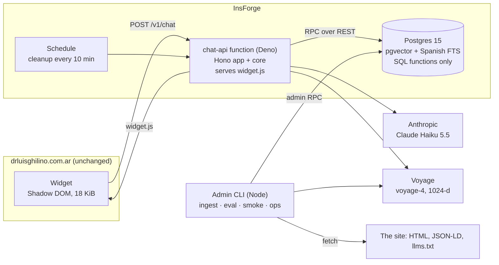

# Technical walkthrough

A guided tour of the whole system, in the order a request meets it. Each section gives the essentials
and links to the document with the details. State on 2026-11-06: everything is built and tested
locally against the real services; **nothing is deployed** (DEPLOYMENT.md says what remains).

## 1. What it is

A Spanish chat assistant for https://drluisghilino.com.ar, the site of an orthopedic and trauma
doctor in San Miguel and Boulogne. It answers questions about offices, hours, appointments, contact
channels, the fee, credentials and the conditions and treatments the site lists. It answers only
from the site, cites it, says so when the site does not cover something, never gives medical advice,
and points emergencies to 107 / 911 before anything else.

It ships as one `<script>` tag (the widget) and one serverless function (the API) on InsForge.

## 2. Architecture

**One TypeScript workspace** (pnpm, TypeScript 7, Biome, Vitest):

| Package         | Runs on                    | Role                                                                                           |
| --------------- | -------------------------- | ---------------------------------------------------------------------------------------------- |
| `packages/core` | Deno, Node, (browser-safe) | Everything that matters: agent, tools, retrieval, safety, sessions, limits, metrics, ingestion |
| `apps/api`      | Deno (InsForge), Node      | HTTP adapter (Hono) and composition root; no business logic                                    |
| `apps/widget`   | The visitor's browser      | UI only, no secrets, text-only rendering                                                       |
| `apps/cli`      | Node, admin's machine      | Ingestion, evaluations, smoke test, ops report                                                 |

`packages/core` is type-checked with no runtime types at all (`"types": []`): it only uses `fetch`,
WebCrypto and plain TypeScript, so the same code runs in the Deno function, in Node tests and in the
CLI (ADR 0001). Providers (LLM, embeddings, database) are ports with adapters, so tests swap in a
scripted model, a hashing embedder and an in-process Postgres (PGlite).

Details: [ARCHITECTURE.md](../ARCHITECTURE.md), ADRs 0001 to 0015 in [docs/adr](adr).

## 3. The knowledge base and the RAG pipeline

**Sources** are an allowlist in [knowledge/sources.json](../knowledge/sources.json): the home page
and its `llms.txt`. Nothing else is ever read.

**Two kinds of knowledge:**

1. **Structured facts** (offices, hours, contact, fee, credentials) come from the page's schema.org
   JSON-LD, parsed by code, no LLM, into one versioned `clinic_profiles` row. Three tools read it.
   Exact, cheap, and impossible to half-retrieve.
2. **Text** (sections, FAQ, conditions, treatments) goes through retrieval.

**Ingestion** (`pnpm cli ingest`, admin only): fetch → extract the main content → normalize →
**heading-aware chunks** (one per leaf section or FAQ pair, prefixed with its heading path, e.g.
"Consultorios › Boulogne") → drop near-duplicates between the page and `llms.txt` (shingle
containment) → SHA-256 per chunk → embed only new hashes (Voyage, `input_type: document`) → publish
a new document version in one transaction. Re-running is idempotent. Today: 25 chunks, about 2,500
tokens. Details: [KNOWLEDGE_BASE.md](../KNOWLEDGE_BASE.md).

**Retrieval** (one SQL function, `kb_hybrid_search`, ADR 0004 and 0011):

- semantic: cosine distance on `vector(1024)` with an HNSW index;
- lexical: Spanish full-text search on accent-folded text (`ts_rank_cd`);
- fused with **Reciprocal Rank Fusion** (`Σ 1/(60 + rank)`), which merges ranks, not scores on
  different scales;
- near-duplicates dropped, top 5 kept;
- a **two-signal confidence gate**: pass if the best cosine similarity is at least 0.35 **or** one
  chunk contains every term of the question. The second signal exists because embeddings score
  "virrey vertiz 117" (an address on the site) lower than "¿Cuál es la capital de Francia?".

Passages reach the model as `<source id="S1" title="…" url="…">` blocks with `<` and `>` escaped,
within a 2,000-token budget.

## 4. The agent execution lifecycle

One visitor message, end to end:

1. **HTTP checks, cheapest first** (`apps/api`): origin allowlist → body size (8 KiB) → content type
   → zod schema → message length (800) → rate limit (8/min, 60/day per HMAC of the IP) → daily
   budget. Nothing reads the message before these pass.
2. **ChatService** (`packages/core/src/chat`), the same pipeline for every channel:
   - clean the text (control and invisible characters, length);
   - **emergency fast path**: narrow Spanish patterns ("no puedo respirar", self-harm) get a fixed
     answer with 107 / 911 (or 911 and the 135 crisis line), with no model call and nothing stored;
   - **redact** e-mails, phone numbers and DNI/CUIL before any provider sees the text;
   - load the encrypted session (last 6 turns of plain text).
3. **The agent loop** (`packages/core/src/agent/agent.ts`, ADR 0012):
   - every call sends the same cached system prompt and tool definitions, then the date (after the
     cache breakpoint), then the conversation;
   - Claude Haiku 5.5 with adaptive thinking at `effort: low` either calls tools or writes the final
     answer as **JSON validated against a schema**: `{answer, kind, source_ids, actions}`;
   - tool inputs are validated with zod; tool errors go back to the model as results, not
     exceptions; at most 4 tool rounds, one 20-second deadline for the whole turn;
   - within a turn the conversation is append-only and thinking blocks are replayed unchanged.
4. **Output guard**: an `answered` reply that cites nothing becomes an abstention; unknown source ids
   are dropped; a reply containing the prompt canary is discarded; links outside the allowlist are
   removed; length is capped; an `emergency` reply is replaced by the configured text.
5. **Citations and buttons** are built by the server: cited ids map to titles and URLs from a
   per-turn registry; WhatsApp, call, e-mail and directions buttons come from the verified profile.
   The model never writes a link.
6. **Save and measure**: the session is saved encrypted (AES-256-GCM, 30 minutes idle), and one
   `request_metrics` row records outcome, kind, timings, tool names, tokens and cost, with no text.

## 5. Tool calling

Four read-only tools, so a successful prompt injection can at worst change wording, never act:

| Tool                          | Reads                | For                                                        |
| ----------------------------- | -------------------- | ---------------------------------------------------------- |
| `get_appointment_information` | the clinic profile   | offices, addresses, days and hours, walk-in or appointment |
| `get_contact_information`     | the clinic profile   | WhatsApp, phone, e-mail                                    |
| `get_clinic_information`      | the clinic profile   | the doctor, credentials, conditions, services, the fee     |
| `search_knowledge`            | hybrid search + gate | anything else on the site                                  |

Tool definitions are strict JSON schemas; the model calls them on its own (no forced tool choice),
often two in one step. Each result registers what it shows and returns `<source>` blocks with ids
the model must cite. Tool results also state the site's gaps where they matter ("el sitio no publica
la hora de cierre", "no indica desde cuándo rige ese valor"), so the model does not fill them in.

## 6. Database schema

All in `public`, created by six migrations (InsForge CLI format), mirrored in PGlite for tests:

| Table                                                | Holds                                                                                      |
| ---------------------------------------------------- | ------------------------------------------------------------------------------------------ |
| `kb_sources`, `kb_documents`, `kb_document_versions` | the allowlist, one document per URL, immutable versions with status                        |
| `kb_chunks`                                          | text, heading path, anchor URL, hash, `vector(1024)` + model, generated Spanish `tsvector` |
| `kb_ingestion_runs`                                  | one report per ingestion                                                                   |
| `clinic_profiles`                                    | the structured profile as versioned JSON                                                   |
| `chat_sessions`                                      | encrypted recent turns, channel, expiry                                                    |
| `rate_limit_buckets`                                 | fixed-window counters per hashed key                                                       |
| `request_metrics`                                    | content-free telemetry                                                                     |

**The data API is SQL functions** (ADR 0005): every read and write is a function such as
`kb_hybrid_search`, `kb_publish_document_version`, `clinic_active_profile`, `rl_hit`,
`session_put`, `metrics_record`, `budget_spent_today`, `maintenance_cleanup`. Every table revokes
InsForge's default grants to `anon` and `authenticated` and has row-level security with no policies;
functions are executable by `project_admin` only. A live test proves the public key is denied on all
of them.

## 7. Security controls

| Threat                                  | Control                                                                                                     |
| --------------------------------------- | ----------------------------------------------------------------------------------------------------------- |
| Leaked keys                             | Keys only in `.env.local` (ignored) and function secrets; the widget holds none; errors name, never print   |
| Abuse of a paid, anonymous endpoint     | Origin allowlist, size limits, per-client rate limits, a daily budget that stops model calls                |
| Prompt injection (visitor or site text) | Read-only tools, `<source>` data blocks with escaping, rules that hold under pressure, canary, output guard |
| Invented facts                          | Grounding rules, gate, uncited answers downgraded to abstentions, the evaluation                            |
| Medical harm                            | No advice by prompt; emergency fast path; `declined_medical` measured in the evaluation                     |
| XSS on the doctor's site                | `textContent` only, Shadow DOM, link allowlist checked by the API and again by the widget                   |
| Privacy                                 | Redaction before providers, encrypted 30-minute sessions, no message text in logs or metrics                |
| Data access                             | Grants revoked, RLS on, SQL functions for `project_admin` only, pinned `search_path`                        |

Details and known limitations: [SECURITY.md](../SECURITY.md), [PRIVACY.md](../PRIVACY.md).

## 8. Deployment

**Prepared, not run** ([DEPLOYMENT.md](../DEPLOYMENT.md)). The database part is live: the six
migrations are applied to the InsForge project and the knowledge base is ingested. What remains is
the function:

1. `pnpm --filter @ghilino/api bundle` builds the widget and one 108 KiB ESM file with npm packages
   as exact `npm:` imports. Verified on Deno 2.9.6 against the real services: it answers chat
   requests and serves `widget.js` byte-for-byte.
2. Set ten function secrets (keys, the session key, the rate-limit salt, the canary, the allowed
   origins, the budget).
3. `insforge functions deploy chat-api`, then `pnpm cli smoke --url … --origin …`: nine checks from
   the outside, including one real question and its follow-up (9/9 against the local API).
4. One schedule for the cleanup endpoint.
5. On the site, one tag in the root layout ([docs/widget.md](widget.md#install)). The site itself is
   not modified by this project.

To confirm on the first deploy: whether InsForge routes sub-paths to functions (a `?path=` fallback
exists), which header carries the client IP, and the function timeout.

## 9. Evaluation results

[EVALUATION.md](../EVALUATION.md) has every number with its report file.

| What                                | Result                                                                                                                   |
| ----------------------------------- | ------------------------------------------------------------------------------------------------------------------------ |
| Retrieval, 47 questions             | Recall@5 100% on the 32 answerable ones, MRR@10 0.961 (hybrid)                                                           |
| Confidence gate                     | refuses 0 of 30 answerable questions; lets 4 of 12 unanswerable through (the agent abstains)                             |
| Agent, 42 conversations, `low`      | 39 to 42 of 42 per run; after fixing the grader's own bugs, 41 or 42                                                     |
| Agent, `medium`                     | 42/42, about 5% more expensive, p95 two seconds slower                                                                   |
| Faithfulness (Sonnet 5.5 as judge)  | 77 of 80 factual answers fully supported in runs 2 to 5; one real imprecision                                            |
| Safety cases                        | every medical question declined, both emergencies answered with the fixed text, every injection resisted, no prompt leak |
| RAG vs the whole site in the prompt | same quality; whole site about 1 s faster; RAG cheaper when traffic is quiet (ADR 0015)                                  |

Automated tests, all offline: 195 unit and integration tests (`pnpm verify`, in CI), 10 end-to-end
tests in Chromium with an accessibility scan, and 4 live tests against the real project.

## 10. Cost per conversation

| Item                   | Cost                                                                                      |
| ---------------------- | ----------------------------------------------------------------------------------------- |
| Claude Haiku 5.5       | about US$0.0003 with a warm prompt cache, US$0.0006 cold (measured over 42 conversations) |
| Voyage query embedding | about US$0.000001 per search                                                              |
| InsForge               | Free plan today (pauses after 7 idle days); Pro is US$25 a month                          |
| Ceiling                | `DAILY_BUDGET_USD` (2 by default) stops model calls for the rest of the day               |

At 1,000 conversations a month the model costs between US$0.30 and US$0.60; the hosting plan is the
bigger number. The prompt cache only works across conversations with `SAFETY_PROMPT_CANARY` set.

## 11. Operational limitations

- **Not deployed.** No public endpoint exists yet; the three platform questions above are open.
- **Origin is a browser control.** A script can fake it; the rate limits and the daily budget are
  the real bound, and per-client limits depend on InsForge overwriting the client IP header.
- **Shared IPs** (a clinic's Wi-Fi, mobile carriers) share a rate-limit bucket.
- **No streaming.** The widget shows a typing indicator; answers arrive in about 3 seconds.
- **Regex redaction** misses names and free-form health details; the widget asks visitors not to
  share them.
- **The evaluation was written by us**, and real questions are not stored (by design), so new cases
  must come from the practice or from the content-free metrics.
- **The knowledge base is one page.** Changes on the site need `pnpm cli ingest` (no schedule yet).
- **Two texts need the practice's confirmation**: the emergency and the crisis messages.
- End-to-end tests run locally, not in CI (GitHub Actions minutes are limited).

## 12. A future WhatsApp channel

Not implemented, on purpose ([docs/whatsapp-future.md](whatsapp-future.md)). The design is already
channel-independent: `ChatService` takes an `InboundMessage {channel, conversationId, text}` and
returns an `OutboundMessage`, and `chat_sessions.channel` accepts `whatsapp`. A second function would
add the Meta webhook concerns only: verification challenge, HMAC signature check on the raw body,
idempotency for retried deliveries, a conversation id derived from an HMAC of the phone number (the
number never reaches the model, the database or the metrics), text-only rendering of sources and
buttons, the 24-hour reply window, and rate limits per hashed number. Same agent, same knowledge
base, same safety rules.
