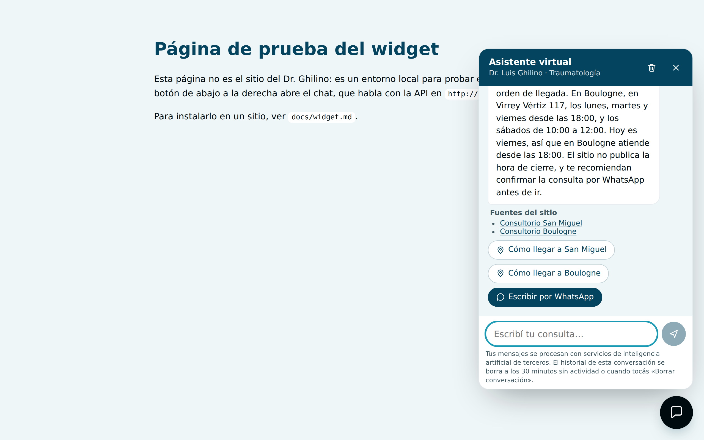

# The chat widget

One script tag adds a floating chat button to any page. The widget is plain TypeScript in a Shadow
DOM: about 18 KiB, no framework, no cookies, no trackers, no dependencies.



## Install

The API function serves the script itself (`GET /widget.js`), so there is nothing else to host.
InsForge passes the route in `?path=` (DEPLOYMENT.md, "What the first deploy showed"), so both URLs
use that form. Add this before `</body>`, once per page:

```html
<script
  src="https://c94k6z7z.us-east.insforge.app/functions/chat-api?path=/widget.js"
  data-api="https://c94k6z7z.us-east.insforge.app/functions/chat-api?path=/"
  defer
></script>
```

**On the doctor's site** (Next.js, App Router) it is a component rendered once in the root layout
(`src/components/assistant-widget.tsx` in `tomasghilino/luisGhilinoMedico`, PR #5, 2026-11-06):

```tsx
<Script
  src={`${site.assistantApi}?path=/widget.js`}
  data-api={`${site.assistantApi}?path=/`}
  data-position="left"
  strategy="lazyOnload"
/>;
```

- Only when `VERCEL_ENV === "production"`, like Google Analytics: previews are not in
  `ALLOWED_ORIGINS`, so the chat could not answer there.
- `lazyOnload`: the script loads when the browser is idle, after the page.
- `data-position="left"`: the site's WhatsApp button is bottom right.
- Tested before publishing with a local production build against the deployed API, on desktop and
  phone sizes: it answered with sources and buttons, no JavaScript errors.

If a `Content-Security-Policy` is ever added to the site (there is none today), allow
`https://c94k6z7z.us-east.insforge.app` in `script-src` and `connect-src`. To remove the assistant,
delete the component from the layout; nothing else on the site changes.

| Attribute       | Required | Meaning                                                                               |
| --------------- | -------- | ------------------------------------------------------------------------------------- |
| `data-api`      | yes      | Base URL of the chat API. With a query string (`…?path=/`), the route goes in `path`. |
| `data-position` | no       | `right` (default) or `left`.                                                          |
| `data-open`     | no       | `true` opens the panel on load (for a dedicated help page; not for every page).       |

The page's origin must be in the API's `ALLOWED_ORIGINS`, or every message gets a 403.

## What the visitor sees

- A round navy button (the site's colours). It opens a panel; on phones the panel takes the whole
  screen.
- The disclosure first: an AI assistant, answers from the site, not a medical consultation, do not
  share personal or health data, it can be wrong.
- A greeting and four suggested questions.
- Answers as text, with "Fuentes del sitio" (links to the section of the site each answer used) and
  contact buttons (WhatsApp, call, e-mail, directions) when they help.
- A trash button: "Borrar conversación" deletes the server copy and clears the screen.

## Behaviour and guarantees

- **Text only.** Every string from the API is set with `textContent`. A reply containing
  `` shows those characters; it never becomes HTML (end-to-end test).
- **Allowed links only.** Sources must be `https://drluisghilino.com.ar/…`; buttons must be WhatsApp,
  Google Maps, `tel:` or `mailto:`. Anything else is not rendered as a link (unit and e2e tests).
  External links open in a new tab with `rel="noopener noreferrer"`.
- **No storage in the browser.** The conversation id and the messages live in memory; a reload starts
  a new conversation. The server copy expires after 30 minutes.
- **Isolation.** Shadow DOM: the site's CSS cannot break the widget and the widget's CSS cannot
  leak into the site. Styles use a constructable stylesheet where available, so a strict CSP on the
  page does not have to allow inline `<style>`.
- **Accessibility.** The launcher is a labelled button with `aria-expanded`; the panel is a labelled
  dialog; messages are in a `role="log"` live region; errors use `role="alert"`; Escape closes and
  returns focus to the launcher; Enter sends and Shift+Enter adds a line; visible focus rings;
  16 px input (no zoom on iOS); `prefers-reduced-motion` turns animations off. axe-core reports no
  serious or critical violations (end-to-end test).
- **Failures.** If the config endpoint is unreachable, built-in texts are used. Errors (rate limit,
  outage) appear as a message with the WhatsApp button the API sends.

## Develop

```bash
ALLOWED_ORIGINS=http://localhost:5173 pnpm dev:api     # real API on :8787 with .env.local
pnpm --filter @ghilino/widget dev                      # demo page on http://localhost:5173
pnpm --filter @ghilino/widget build                    # apps/widget/dist/widget.js
pnpm test:e2e                                          # Chromium tests (PGlite, scripted model)
```

The demo page says on its face that it is not the doctor's site.
